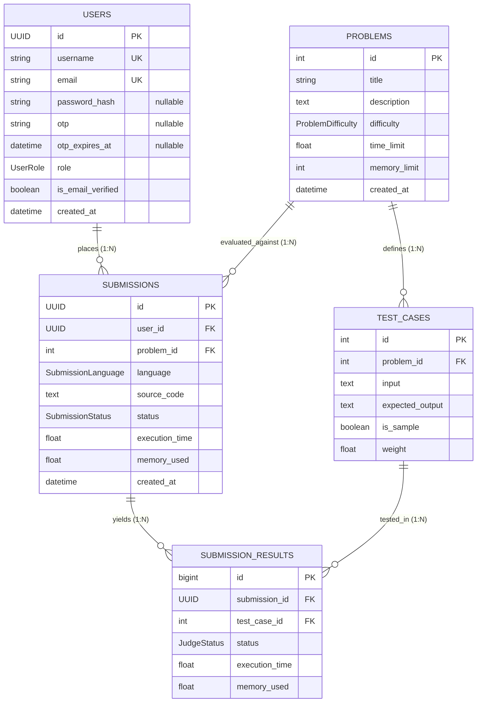

# ⚡ Code-Execution-Engine

[](LICENSE)

A scalable, asynchronous remote code execution engine built with **FastAPI**, **Redis**, and **Docker**. Designed for competitive programming platforms and online judges (like LeetCode, Codeforces, or HackerRank), it safely compiles and executes untrusted code in isolated, resource-constrained container sandboxes across multiple programming languages.

---

## 🌟 Highlights

- **Reusable Docker Container Engine**: Features a custom-built, modular class (`DockerContainerEngine`) created specifically to handle secure container lifecycle, compilation, sandboxed execution, resource quotas, and cleanup.
- **Asynchronous Task Queue**: Uses Redis queues (`BRPOP`/`LPUSH`) to decouple HTTP ingestion from heavy code execution workloads.
- **Multi-Language Support**: Compiles and runs **C**, **C++**, **Java**, and **Python**.
- **Security Sandboxing**: Containers run with **zero network access** (`--network none`) and strict memory (`--memory`) and CPU (`--cpus`) limits.
- **Dynamic Template Stitching**: Leverages **Jinja2** to wrap user solutions into driver code harnesses (`main_code` + `user_code`).
- **Comprehensive Problem Management**: Includes relational database models (PostgreSQL via SQLAlchemy & Alembic) to store problem statements, test cases, and language-specific templates.

---

## 🚀 The Reusable `DockerContainerEngine` Class

A central contribution of this project is the **`DockerContainerEngine`** class located in [`worker/container.py`](worker/container.py). It abstracts away low-level Docker CLI interactions into an intuitive, reusable Python interface for compiling and executing code inside isolated containers.

### Key Capabilities:
1. **Host & Container Isolation**:
   - Automatically attaches `--network none` to prevent untrusted code from making external network calls.
   - Enforces configurable resource constraints (default: `128m` RAM, `0.5` CPU cores) to prevent Denial of Service (DoS) attacks, infinite loops, and memory exhaustion.
2. **Lifecycle Management**:
   - Starts containers in the background (`sleep infinity`), attaches host directories via volume mounts (`-v <mount>:/shared`), and provides graceful force-cleanup (`docker rm -f`).
3. **Smart Compilation & Execution**:
   - Distinguishes compiled languages (`c`, `cpp`, `java`) from interpreted languages (`python`).
   - Automatically selects appropriate compiler toolchains (`gcc`, `g++`, `javac`) and runtime commands.
   - Captures standard output (`stdout`), standard error (`stderr`), and exit codes (`returncode`).

### Reusable Example Usage

You can easily import and reuse `DockerContainerEngine` in any external script or project:

```python
from worker.container import DockerContainerEngine

# 1. Initialize the container engine with custom resource limits and volume mount
container = DockerContainerEngine(
    image_name="gcc:12.5",
    memory_limit="128m",
    cpu_limit="0.5",
    volume_mount="/path/to/code_directory",
)

try:
    # 2. Spin up the sandboxed container
    container_id = container.start_container()
    print(f"Container started: {container_id}")

    # 3. Compile source code (e.g. C / C++ / Java)
    compile_result = container.compile_code(language="cpp", folder_name="submission_123")
    if not compile_result["compiled"]:
        print(f"Compilation Error: {compile_result['stderr']}")
    else:
        # 4. Execute the binary with standard input data
        exec_result = container.execute_code(
            language="cpp", input_data="42\n", folder_name="submission_123"
        )
        print(f"Output: {exec_result['stdout']}")
        print(f"Exit Code: {exec_result['returncode']}")

finally:
    # 5. Clean up and remove the container
    container.remove_container()
```

---

## 🏗️ Architecture & Workflow

```
[ Client ] 
    │
    ├──► 1a. POST /api-v1/code/run (mode="run", custom or sample test cases)
    │        ↳ Quick verification; returns outputs/errors; DOES NOT update marks
    │
    └──► 1b. POST /api-v1/code/submit (mode="submit", test cases loaded internally)
             ↳ Official evaluation; updates marks & leaderboard; test cases hidden
    │
    ▼
[ FastAPI Server ] ──► Stores metadata in Redis Hash (`submission:<id>`, with `mode`)
    │              ──► Prepares workspace directory (`app/code/<id>/`)
    │              ──► Pushes job into Redis Queue (`code:queue`)
    │
    ▼
[ Redis Queue ] (Broker)
    │
    │ 2. Worker fetches job via BRPOP
    ▼
[ Worker Service ]
    │
    ├──► 3. Instantiates `DockerContainerEngine`
    ├──► 4. Starts sandboxed container (--network none, memory/cpu limits)
    ├──► 5. Compiles code (if C/C++/Java)
    ├──► 6. Evaluates test cases sequentially with stdin/stdout
    ├──► 7. Computes results, execution time, and passed test counts
    ├──► 8. Writes verdict to Redis (`submission:<id>`), sets durable `result:<id>`, and PUBLISHes:
    │        - mode="submit": sanitizes output (hides internal test cases) & updates DB + leaderboard
    │        - mode="run": preserves outputs & skips DB leaderboard updates
    └──► 9. Teardown container & cleans up host files
    │
    ▼
[ Redis Pub/Sub ] ──► Pushes live event to FastAPI SSE stream
    │
    ▼ 10. GET /stream/{id} (Server-Sent Events) or GET /submission/poll/{id}
[ Client ]
```


---

## 🗄️ Database Schema & Relationship Model

The platform uses **PostgreSQL** managed through **SQLAlchemy 2.0 (asyncio)** and **Alembic**. All dependency commands and migrations are executed using **`uv`**.

### 1. Entity-Relationship Diagram (ERD)



---

### 2. Relationship Model & Foreign Keys

| Parent Model | Child Model | Foreign Key | Cardinality | Cascade Rule | Description |
| :--- | :--- | :--- | :--- | :--- | :--- |
| **`User`** (`users`) | **`Submission`** (`submissions`) | `submissions.user_id -> users.id` | **1 : N** | `ON DELETE CASCADE` | A user can submit multiple code attempts. Deleting a user purges all their submissions. |
| **`Problem`** (`problems`) | **`TestCase`** (`test_cases`) | `test_cases.problem_id -> problems.id` | **1 : N** | `ON DELETE CASCADE` | A problem contains multiple test cases. Removing a problem automatically removes all its test cases. |
| **`Problem`** (`problems`) | **`Submission`** (`submissions`) | `submissions.problem_id -> problems.id` | **1 : N** | `ON DELETE CASCADE` | A problem tracks all submissions attempted against it. |
| **`Submission`** (`submissions`) | **`SubmissionResult`** (`submission_results`) | `submission_results.submission_id -> submissions.id` | **1 : N** | `ON DELETE CASCADE` | Each submission generates detailed test-case level execution results. |
| **`TestCase`** (`test_cases`) | **`SubmissionResult`** (`submission_results`) | `submission_results.test_case_id -> test_cases.id` | **1 : N** | `ON DELETE CASCADE` | Individual test case outcomes reference the corresponding test case definition. |

---

### 3. Model Specifications

#### `User` (`users`)
Stores account credentials, OTP states, access roles, and email verification status.
- **`id`** (`UUID`, Primary Key): Universally unique identifier preventing user enumeration.
- **`username`** (`VARCHAR(50)`, Unique, Indexed): User handle (mandatory unique name during registration).
- **`email`** (`VARCHAR(255)`, Unique, Indexed): User email address.
- **`password_hash`** (`VARCHAR(255)`, Nullable): Optional cryptographic password hash (allows passwordless OTP accounts).
- **`otp`** (`VARCHAR(6)`, Nullable): Active one-time passcode for email verification / authentication.
- **`otp_expires_at`** (`TIMESTAMPTZ`, Nullable): Expiry timestamp for the active OTP.
- **`role`** (`ENUM('user', 'admin', 'moderator')`): Authorization role.
- **`is_email_verified`** (`BOOLEAN`): Verification flag indicating whether the user's email address has been verified.
- **`created_at`** (`TIMESTAMPTZ`): Timezone-aware UTC registration timestamp.

#### `Problem` (`problems`)
Stores coding challenge statements and resource constraints.
- **`id`** (`INTEGER`, Primary Key, Autoincrement): Unique problem identifier.
- **`title`** (`VARCHAR(255)`, Indexed): Problem name.
- **`description`** (`TEXT`): Full markdown problem description and instructions.
- **`difficulty`** (`ENUM('easy', 'medium', 'hard')`, Indexed): Problem complexity level.
- **`time_limit`** (`FLOAT`): Execution time limit in seconds.
- **`memory_limit`** (`INTEGER`): Maximum memory allocation in megabytes (MB).
- **`created_at`** (`TIMESTAMPTZ`): Timezone-aware UTC creation timestamp.

#### `TestCase` (`test_cases`)
Stores individual inputs and expected outputs for problem evaluation.
- **`id`** (`INTEGER`, Primary Key, Autoincrement): Unique test case identifier.
- **`problem_id`** (`INTEGER`, Foreign Key `problems.id`, Indexed): Associated problem.
- **`input`** (`TEXT`): Standard input (`stdin`) provided to the program.
- **`expected_output`** (`TEXT`): Target standard output (`stdout`) expected.
- **`is_sample`** (`BOOLEAN`): Set to `True` for example test cases visible to the user.
- **`weight`** (`FLOAT`): Score weight assigned to this test case.

#### `Submission` (`submissions`)
Records code runs and overall verdicts.
- **`id`** (`UUID`, Primary Key): Unique submission run identifier.
- **`user_id`** (`UUID`, Foreign Key `users.id`, Indexed): Submitting user.
- **`problem_id`** (`INTEGER`, Foreign Key `problems.id`, Indexed): Problem being solved.
- **`language`** (`ENUM('python', 'cpp', 'c', 'java', 'javascript')`): Programming language.
- **`source_code`** (`TEXT`): Submitted source code string.
- **`status`** (`ENUM('pending', 'queued', 'running', 'accepted', 'wrong_answer', 'time_limit_exceeded', 'memory_limit_exceeded', 'compilation_error', 'runtime_error', 'internal_error')`, Indexed): Evaluation verdict.
- **`execution_time`** (`FLOAT`, Nullable): Total execution duration in seconds.
- **`memory_used`** (`FLOAT`, Nullable): Peak memory consumed in megabytes (MB).
- **`created_at`** (`TIMESTAMPTZ`, Indexed): Timezone-aware submission timestamp.

#### `SubmissionResult` (`submission_results`)
Stores per-testcase execution metrics for a submission.
- **`id`** (`BIGINT`, Primary Key, Autoincrement): Result identifier.
- **`submission_id`** (`UUID`, Foreign Key `submissions.id`, Indexed): Parent submission run.
- **`test_case_id`** (`INTEGER`, Foreign Key `test_cases.id`, Indexed): Evaluated test case.
- **`status`** (`ENUM('passed', 'failed', 'time_limit_exceeded', 'memory_limit_exceeded', 'runtime_error', 'compilation_error')`): Per-testcase verdict.
- **`execution_time`** (`FLOAT`, Nullable): Per-testcase execution time in seconds.
- **`memory_used`** (`FLOAT`, Nullable): Per-testcase peak memory used in MB.

---

### 4. Database Operations with `uv`

All database migrations and inspections are executed via `uv`:

```bash
# Apply pending migrations
uv run alembic upgrade head

# Rollback latest migration
uv run alembic downgrade -1

# Verify schema synchronization between models and PostgreSQL
uv run alembic check
```

---

## 📁 Project Structure

```text
code-executor/
├── app/
│   ├── code/                      # Ephemeral directory for code execution jobs
│   ├── config.py                  # Global settings (Redis, Database URLs, connection pools)
│   ├── controllers/
│   │   ├── code_controller.py     # Code execution & streaming controller
│   │   └── user_controller.py     # User registration, OTP authentication & profile controller
│   ├── database.py                # Async SQLAlchemy engine and session setup
│   ├── main.py                    # FastAPI application entrypoint and health routes
│   ├── models/                    # SQLAlchemy models (User, Problem, TestCase, Submission, SubmissionResult)
│   ├── redis_client.py            # Async Redis connection pool setup
│   ├── routers/
│   │   ├── code_routes.py         # Endpoints for code submission and status polling
│   │   ├── root_routes.py         # Health and Redis ping endpoints
│   │   └── user_routes.py         # REST & auth endpoints for user management
│   ├── schemas/
│   │   ├── submission.py          # Pydantic schemas for submissions & test cases
│   │   └── user.py                # Pydantic schemas for users, auth & OTP
│   └── utils/
│       └── security.py            # Bcrypt password hashing & secure OTP generation
├── worker/
│   ├── container.py               # Reusable DockerContainerEngine class
│   └── worker.py                  # Redis worker process consuming code:queue
├── alembic/                       # Database migrations
├── alembic.ini                    # Alembic configuration
├── docker-compose.yml             # Local PostgreSQL & Redis service definitions
├── automate.py                    # Script to automate problem creation & templates
├── create-folder.py               # Helper utility to scaffold problem directories
├── pyproject.toml                 # Project metadata & Python dependencies (uv / pip)
└── README.md
```

---

## 🛠️ Supported Languages & Docker Environments

| Language | Docker Image | Compilation Command | Execution Command |
| :--- | :--- | :--- | :--- |
| **Python** | `python:3.12-alpine` | *Interpreted (None)* | `python /shared/{id}/Main.py` |
| **C** | `gcc:12.5` | `gcc /shared/{id}/Main.c -o /shared/{id}/a.out` | `/shared/{id}/a.out` |
| **C++** | `gcc:12.5` | `g++ /shared/{id}/Main.cpp -o /shared/{id}/a.out` | `/shared/{id}/a.out` |
| **Java** | `java:22` | `javac /shared/{id}/Main.java` | `java -cp /shared/{id} Main` |

---

## ⚙️ Getting Started

### 1. Prerequisites

- **Python**: `>= 3.13` (managed via [`uv`](https://github.com/astral-sh/uv) or `pip`)
- **Docker**: Installed and running daemon
- **PostgreSQL**: Running instance (default: `localhost:5432`)
- **Redis**: Running instance (default: `localhost:6379`)

### 2. Pull Docker Images

Pre-pull the runtime Docker images used by the worker:

```bash
docker pull python:3.12-alpine
docker pull gcc:12.5
docker pull java:22
```

### 3. Spin Up Infrastructure

Start the Redis instance using Docker Compose:

```bash
docker compose up -d
```

### 4. Install Dependencies

Using `uv`:
```bash
uv sync
```
Or using standard `pip`:
```bash
pip install -e .
```

### 5. Run Database Migrations

Apply Alembic migrations to set up the PostgreSQL schema:

```bash
uv run alembic upgrade head
```

---

## 🏃 Running the Application

### 1. Start the FastAPI API Server

```bash
uv run fastapi dev app/main.py --port 8000
```
Interactive Swagger documentation will be available at: [http://localhost:8000/docs](http://localhost:8000/docs)

### 2. Start the Background Worker

In a separate terminal, launch the worker listening to the Redis queue:

```bash
uv run python worker/worker.py
```

---

## 📡 API Reference

### 1. Run Code (`POST /api-v1/code/run` or `/run-code`)

Runs code against custom test cases or sample test cases for immediate feedback. **Does not update user marks or leaderboard.**

- **Endpoint**: `POST /api-v1/code/run`
- **Mode Attribute**: `"run"`
- **Request Body**:
```json
{
  "problem_id": "1",
  "problem_name": "Two Sum",
  "user_code": "def solve():\n    import sys\n    data = sys.stdin.read().split()\n    if data:\n        print(int(data[0]) + int(data[1]))\n\nsolve()",
  "language": "python",
  "mode": "run",
  "test_cases": [
    {
      "input": "2 3\n",
      "expected_output": "5\n"
    }
  ],
  "time_limit": 2.0
}
```
*(Note: If `test_cases` is omitted or empty, sample test cases `is_sample=True` are automatically loaded internally from the database).*

- **Response (`200 OK`)**:
```json
{
  "message": "Run request received successfully.",
  "submission": "f47ac10b-58cc-4372-a567-0e02b2c3d479",
  "status": "queued",
  "mode": "run",
  "streaming_url": "/api-v1/code/stream/f47ac10b-58cc-4372-a567-0e02b2c3d479",
  "polling_url": "/api-v1/code/submission/poll/f47ac10b-58cc-4372-a567-0e02b2c3d479"
}
```

---

### 2. Submit Code (`POST /api-v1/code/submit` or `/submit-code`)

Submits code for official evaluation against **internal test cases loaded from the database**. Evaluates results, **updates user marks & leaderboard stats**, and returns verdicts **without exposing internal test cases**.

- **Endpoint**: `POST /api-v1/code/submit`
- **Mode Attribute**: `"submit"`
- **Request Body** (Client does not need to provide test cases):
```json
{
  "problem_id": "1",
  "user_code": "def solve():\n    import sys\n    data = sys.stdin.read().split()\n    if data:\n        print(int(data[0]) + int(data[1]))\n\nsolve()",
  "language": "python",
  "mode": "submit",
  "time_limit": 2.0
}
```

- **Response (`200 OK`)**:
```json
{
  "message": "Submission received successfully.",
  "submission": "a9b8c7d6-1234-5678-90ab-cdef12345678",
  "status": "queued",
  "mode": "submit",
  "streaming_url": "/api-v1/code/stream/a9b8c7d6-1234-5678-90ab-cdef12345678",
  "polling_url": "/api-v1/code/submission/poll/a9b8c7d6-1234-5678-90ab-cdef12345678"
}
```

---

### 3. Stream Submission Result via Server-Sent Events (SSE)

- **Endpoint**: `GET /api-v1/code/stream/{submission_id}`
- **Header**: `Accept: text/event-stream`
- **Behavior**: Server pushes `: keepalive` heartbeats and pushes the final verdict the moment execution completes via Redis pub/sub.
- **SSE Stream Response**:
```text
: keepalive

event: result
data: {"submission_id": "a9b8c7d6-1234-5678-90ab-cdef12345678", "mode": "submit", "status": "completed", "time_taken": 0.1245, "score": 100.0, "max_score": 100.0, "tests_passed": 2, "total_tests": 2, "results": "[{\"test_case\": 1, \"status\": \"passed\", \"weight\": 50.0, \"score\": 50.0}, {\"test_case\": 2, \"status\": \"passed\", \"weight\": 50.0, \"score\": 50.0}]"}
```

---

### 4. Poll Submission Result

- **Endpoint**: `GET /api-v1/code/submission/poll/{submission_id}`
- **Response for Submit (`200 OK`)** (Internal test cases stripped; shows tests passed count and updates marks):
```json
{
  "submission_id": "a9b8c7d6-1234-5678-90ab-cdef12345678",
  "mode": "submit",
  "status": "completed",
  "score": 100.0,
  "max_score": 100.0,
  "tests_passed": 2,
  "total_tests": 2,
  "time_taken": 0.1245,
  "results": "[{\"test_case\": 1, \"status\": \"passed\", \"weight\": 50.0, \"score\": 50.0}, {\"test_case\": 2, \"status\": \"passed\", \"weight\": 50.0, \"score\": 50.0}]"
}
```
- **Response for Run (`200 OK`)** (Preserves outputs & test cases for debugging; does not update marks):
```json
{
  "submission_id": "f47ac10b-58cc-4372-a567-0e02b2c3d479",
  "mode": "run",
  "status": "completed",
  "score": 100.0,
  "max_score": 100.0,
  "tests_passed": 1,
  "total_tests": 1,
  "time_taken": 0.0821,
  "output": "5\n",
  "test_cases": "[{\"input\": \"2 3\\n\", \"expected_output\": \"5\\n\", \"weight\": 1.0}]",
  "results": "[{\"status\": \"passed\", \"output\": \"5\\n\", \"error\": \"\", \"weight\": 1.0, \"score\": 1.0}]"
}
```


### 4. Problem Template Management

- `POST /problem-templates/`: Create problem statement and default test cases.
- `GET /problem-templates/`: List all problem templates.
- `GET /problem-templates/{problem_id}`: Fetch problem statement with all language templates.
- `POST /problem-templates/{problem_id}/languages/{language}`: Add or update language-specific source templates.

### 5. User Management & Authentication (`/api-v1/users`)

The platform supports both traditional password authentication (via Bcrypt) and email verification / passwordless login with 6-digit email OTPs. Users register with a mandatory unique handle and verify their email via OTP.

| Method | Endpoint | Description | Status |
| :--- | :--- | :--- | :--- |
| `POST` | `/api-v1/users/register` | Register user account with mandatory unique username and optional password (dispatches verification OTP) | `201 Created` |
| `POST` | `/api-v1/users/login` | Authenticate with email/username and password (requires verified email) | `200 OK` |
| `POST` | `/api-v1/users/otp/request` | Issue 6-digit OTP to registered user for email verification / login | `200 OK` |
| `POST` | `/api-v1/users/otp/verify` | Validate OTP passcode, mark email verified, grant login, and invalidate code | `200 OK` |
| `GET` | `/api-v1/users/check-username/{username}` | Check username handle availability (returns `is_available: true/false`) | `200 OK` |
| `GET` | `/api-v1/users/` | Paginated user profile listing (supports `role` filter, `skip`, `limit`) | `200 OK` |
| `GET` | `/api-v1/users/{user_id}` | Fetch public user profile by UUID | `200 OK` |
| `GET` | `/api-v1/users/username/{username}` | Fetch public user profile by handle | `200 OK` |
| `PATCH` | `/api-v1/users/{user_id}` | Update username, email, password, role, or verification status | `200 OK` |
| `DELETE` | `/api-v1/users/{user_id}` | Delete user account and cascade delete submissions | `200 OK` |

#### Example: Registration & Email Verification via OTP Flow
```bash
# 1. Check if username is available (returns {"username": "bob_coder", "is_available": true, "available": true})
curl -X GET "http://localhost:8000/api-v1/users/check-username/bob_coder"

# 2. Register user (username is mandatory and unique)
curl -X POST "http://localhost:8000/api-v1/users/register" \
  -H "Content-Type: application/json" \
  -d '{"username": "bob_coder", "email": "bob@example.com", "password": "SecretPassword123"}'

# 3. (Optional) Request a new OTP if needed
curl -X POST "http://localhost:8000/api-v1/users/otp/request" \
  -H "Content-Type: application/json" \
  -d '{"email": "bob@example.com"}'

# 3. Verify OTP code (marks is_email_verified = true and authenticates)
curl -X POST "http://localhost:8000/api-v1/users/otp/verify" \
  -H "Content-Type: application/json" \
  -d '{"email": "bob@example.com", "otp": "234487"}'
```


---

## 🔒 Security & Sandboxing Features

Running untrusted user-submitted code requires rigorous sandboxing:
- **No Network Egress**: Docker flag `--network none` guarantees that malicious code cannot initiate outbound network requests, port scans, or participate in botnets.
- **Resource Constraints**: Strict limits on RAM (`--memory 128m`) and CPU cores (`--cpus 0.5`) defend the host machine from fork-bombs and memory leak exploits.
- **Isolated Ephemeral Volumes**: Every submission runs in an isolated directory (`app/code/<submission_id>`), which is cleaned up immediately after evaluation.
- **Ephemeral Container Lifetime**: Each execution creates a dedicated container that is forcefully terminated and deleted (`docker rm -f`) post-run.

---

## 🧪 Testing

The project uses `pytest` and `pytest-asyncio` orchestrated via `uv`.
Tests run against an isolated PostgreSQL test database (`code_buddy_test`) and Redis with automatic cleanup fixtures:

```bash
# Ensure services are up
docker compose up -d

# Run all tests
uv run pytest -v

# Run individual route test suites
uv run pytest tests/test_root_routes.py -v
uv run pytest tests/test_code_routes.py -v
uv run pytest tests/test_user_routes.py -v
```

For complete details on test architecture, fixtures, and coverage, see [tests/README.md](tests/README.md).

---

## 👤 Author

Developed by **Abhishek** ([@Abhishekkrsingh2023](https://github.com/Abhishekkrsingh2023)).
- Designed and engineered the architecture, asynchronous pipeline, and the reusable **`DockerContainerEngine`** for sandboxed execution.

---

## 📄 License

This project is licensed under the MIT License - see the [LICENSE](LICENSE) file for details.

